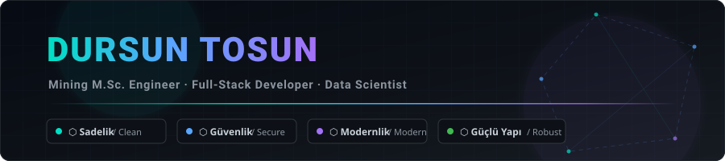

<div align="center">

  <!-- Custom High-Res Vector Header Banner -->
  <a href="https://github.com/drsntsn">
    
  </a>

  <br/><br/>

  <!-- Dynamic Typing SVG -->
  <a href="https://github.com/drsntsn">
    
  </a>

  <br/><br/>

  <!-- Social & Engineering Badges -->
  <a href="https://github.com/drsntsn">
    
  </a>
  <a href="https://github.com/drsntsn">
    
  </a>
  <a href="https://github.com/drsntsn">
    
  </a>
  <a href="mailto:drsntsn@users.noreply.github.com">
    
  </a>

</div>

---

### 👨‍💻 Hakkımda / About Me & Engineering Identity

Ben bir **Maden Yüksek Mühendisi (M.Sc. Mining Engineer)**, **Full-Stack Developer** ve **Veri Uzmanıyım (Data Specialist)**.

Mühendislik formasyonundan gelen analitik modelleme ve matematiksel problem çözme disiplinimi, çağdaş tam yığın (full-stack) yazılım mimarileri ve veri bilimiyle birleştiriyorum. Çalışmalarım maden jeolojisi, sondaj ve jeodezik hesaplamalardan endüstriyel proses kalibrasyonuna, büyük veri işleme hatlarından modern web ve mobil platformlarına kadar uzanmaktadır.

I am a **Mining M.Sc. Engineer**, **Full-Stack Developer**, and **Data Specialist** dedicated to architecting clean, resilient, and mathematically verified software systems. My multidisciplinary skill set bridges heavy physical engineering with modern digital engineering:

* ⛏️ **Maden Mühendisliği & Jeoteknik Modelleme (Mining & Geotechnical Engineering):**  
  Maden sahası sondaj logları, stratigrafik katman modellemesi, rezerv hesaplama, açık/kapalı ocak planlaması, patlatma/kırma optimizasyonu ve jeodezik koordinat dönüşümleri (UTM, WGS-84 Vincenty, MGRS, Gauss-Kruger).
* 📊 **Veri Uzmanlığı & Analitik (Data Engineering & Applied Analytics):**  
  Sayısal algoritmalar, ampirik kalibrasyon tabloları üzerinden hassas enterpolasyon, veri temizleme ve modelleme, makine öğrenmesi regresyon modelleri ve büyük veri boru hatları (data pipelines).
* 💻 **Full-Stack Yazılım Mimarisi (Full-Stack Software Architecture):**  
  Node.js, Python, Flutter, modern ECMAScript/Vanilla JS, semantik CSS mimarisi, REST/GraphQL API tasarımı, güvenli veri tabanı yönetimi ve mikro-servis kurguları.

Tüm projelerim **4 Ana Temel İlke** doğrultusunda inşa edilir:

```text
┌────────────────────────────────────────────────────────────────────────┐
│                      THE 4 CORE ENGINEERING PILLARS                    │
├────────────────────┬────────────────────┬──────────────────────────────┤
│ 1. Sadelik         │ Simplicity         │ Sıfır gereksiz karmaşıklık,  │
│                    │                    │ yalın ve modüler kod yapısı. │
├────────────────────┼────────────────────┼──────────────────────────────┤
│ 2. Güvenlik        │ Ironclad Security  │ Sıfır sır sızıntısı, OWASP   │
│                    │                    │ standartları, güvenli sınır. │
├────────────────────┼────────────────────┼──────────────────────────────┤
│ 3. Modernlik       │ Modernity          │ Güncel dil özellikleri,      │
│                    │                    │ ergonomik ve akıcı UX/UI.    │
├────────────────────┼────────────────────┼──────────────────────────────┤
│ 4. Güçlü Yapı      │ Robust Systems     │ Tip güvenliği, otomatik      │
│                    │                    │ birim testler, sıfır sapma.  │
└────────────────────┴────────────────────┴──────────────────────────────┘
```

---

### 🗺️ Ekosistem & Mühendislik Odak Alanları

Açık kaynak ve kişisel mühendislik çalışmalarım 5 ana sinerjik eksende toplanmıştır:

<table>
  <tr>
    <td width="50%" valign="top">
      <h4>⛏️ 1. Madencilik, Jeodezi & Sondaj Sistemleri</h4>
      <p>Yüksek hassasiyetli hesaplamalı geometri, haritacılık ve maden jeolojisi boru hatları.</p>
      <ul>
        <li><b><a href="https://github.com/drsntsn/sondaj">sondaj</a> & <a href="https://github.com/drsntsn/python_sondaj_projesi">python_sondaj_projesi</a></b>: Maden sondaj logları, stratigrafi ve litoloji katman analizleri.</li>
        <li><b><a href="https://github.com/drsntsn/geodesy_master">geodesy_master</a></b>: WGS-84 Vincenty milimetre hassasiyetli jeodezik mesafe, UTM ve NATO MGRS dönüşümleri.</li>
        <li><b><a href="https://github.com/drsntsn/cokgen_alan_hesabi">cokgen_alan_hesabi</a></b>: Gauss Shoelace formülüyle maden ruhsat alanı, parsel ve poligon köşe koordinat hesaplamaları.</li>
        <li><b><a href="https://github.com/drsntsn/cevir-turkiye-d">cevir-turkiye-d</a></b>: Türkiye lokal projeksiyon ve koordinat dönüşüm araçları.</li>
      </ul>
    </td>
    <td width="50%" valign="top">
      <h4>🧪 2. Endüstriyel Yoğunluk, Enerji & Proses Stüdyosu</h4>
      <p>Laboratuvar kalitesinde fizikokimya ve endüstriyel telemetri motorları.</p>
      <ul>
        <li><b><a href="https://github.com/drsntsn/hmert">hmert</a></b>: Köhler AEL.TF.19 kombi sayaç telemetrisi, EPDK reaktif ceza/kompanzasyon analizi ve dansite kalibratörü.</li>
        <li><b><a href="https://github.com/drsntsn/bomecetveli">bomecetveli</a> & <a href="https://github.com/drsntsn/bome_html">bome_html</a></b>: Baumé (°Bé) derecesi ve Sodyum Sülfat ($Na_2SO_4$) yoğunluk kalibrasyon enterpolatörü.</li>
        <li><b><a href="https://github.com/drsntsn/Cozelti">Cozelti</a></b>: Çözelti konsantrasyonu, seyreltme ve karışım oranları hesaplayıcıları.</li>
      </ul>
    </td>
  </tr>
  <tr>
    <td width="50%" valign="top">
      <h4>⚡ 3. Sayısal Algoritmalar & Veri Uzmanlığı</h4>
      <p>Kayan nokta sapmasından (floating-point drift) arındırılmış yüksek hassasiyetli matematik motorları.</p>
      <ul>
        <li><b><a href="https://github.com/drsntsn/toplama_js">toplama_js</a> & <a href="https://github.com/drsntsn/toplama_html">toplama_html</a></b>: IEEE 754 güvenli sayı toplayıcı, gerçek zamanlı istatistiksel analiz (ortalama, medyan, varyans, standart sapma).</li>
        <li><b><a href="https://github.com/drsntsn/2024_il_ilce_sql">2024_il_ilce_sql</a></b>: Türkiye mülki idare ve coğrafi bilgi veri tabanı mimarisi.</li>
        <li><b><a href="https://github.com/drsntsn/borsamsi">borsamsi</a></b>: BIST hisse maliyet düşürme simülatörü ve lot amortisman motoru.</li>
      </ul>
    </td>
    <td width="50%" valign="top">
      <h4>🍽️ 4. Full-Stack Web & Mobil SaaS Ekosistemleri</h4>
      <p>Uçtan uca ticari dijital işletme ve sipariş platformları.</p>
      <ul>
        <li><b><a href="https://github.com/drsntsn/qr_menu_web">qr_menu_web</a></b>: Modern web tabanlı restoran menü, kategori ve fiyat yönetim paneli.</li>
        <li><b><a href="https://github.com/drsntsn/qr_menu_flutter">qr_menu_flutter</a></b>: iOS ve Android platformları için reaktif sipariş ve masaya servis mobil istemcisi.</li>
        <li><b><a href="https://github.com/drsntsn/css_only_floating_label">css_only_floating_label</a> & <a href="https://github.com/drsntsn/css3d_ve_bilesenler">css3d_ve_bilesenler</a></b>: Sıfır-JS modern UI/UX tasarım sistemleri.</li>
      </ul>
    </td>
  </tr>
  <tr>
    <td colspan="2" valign="top">
      <h4>🏡 5. Akıllı IoT, Donanım & Makine Öğrenmesi</h4>
      <p>Mikrodenetleyici sensör izleme ve makine öğrenmesi destekli tahminleme motorları.</p>
      <ul>
        <li><b><a href="https://github.com/drsntsn/home-eco-manager">home-eco-manager</a> & <a href="https://github.com/drsntsn/Arduino">Arduino</a></b>: Sıcaklık, enerji ve su tüketimi telemetrisi sunan IoT donanım entegrasyonu.</li>
        <li><b><a href="https://github.com/drsntsn/EvFiyatTahmini">EvFiyatTahmini</a> & <a href="https://github.com/drsntsn/vericekme">vericekme</a></b>: Otomatik gayrimenkul veri madenciliği ve makine öğrenmesi fiyat tahminleme modelleri.</li>
      </ul>
    </td>
  </tr>
</table>

---

### 🛠️ Teknik Yetkinlikler & Araç Seti

<div align="center">

  <!-- Diller -->
  <p><b>Programlama Dilleri</b></p>
  
  
  
  
  
  

  <br/>

  <!-- Web & Veri Çatıları -->
  <p><b>Web, Mobil & Veri Mimarisi</b></p>
  
  
  
  
  
  

  <br/>

  <!-- Mühendislik ve Test Araçları -->
  <p><b>Mühendislik, Test & Güvenlik</b></p>
  
  
  
  
  

</div>

---

### 📊 GitHub İstatistikleri

<div align="center">
  <table border="0">
    <tr>
      <td align="center">
        
      </td>
      <td align="center">
        
      </td>
    </tr>
    <tr>
      <td colspan="2" align="center">
        
      </td>
    </tr>
  </table>
</div>

---

### ⚡ Öne Çıkan Notlar & Vizyon

- ⛏️ **Maden Yüksek Mühendisliği**: Sondaj logları, katman korelasyonu, jeofizik/jeodezik haritalama ve maden sahası veri otomasyonu.
- 📊 **Veri Uzmanlığı**: İstatistiksel veri modelleme, sayısal optimizasyon ve büyük veri işleme hatları.
- 💻 **Full-Stack Geliştirici**: Web, mobil ve gömülü sistemlerde uçtan uca modern, güvenli ve yüksek performanslı çözümler.
- 🛡️ **Sıfır Sızıntı & Disiplin**: Otomatik güvenlik denetimleri, çevre değişkeni izolasyonu ve yüksek test kapsamı.

---

<div align="center">

  <!-- Custom High-Res Vector Footer Banner -->
  <a href="https://github.com/drsntsn">
    
  </a>

</div>
