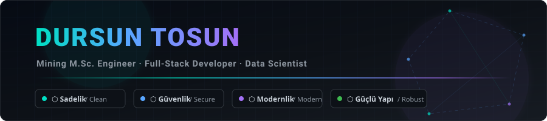

<div align="center">

  <!-- Custom High-Res Vector Header Banner -->
  <a href="https://github.com/drsntsn">
    
  </a>

  <br/><br/>

  <!-- Dynamic Typing SVG -->
  <a href="https://github.com/drsntsn">
    
  </a>

  <br/><br/>

  <!-- Social & Engineering Badges -->
  
  
  
  
  <a href="https://github.com/drsntsn?tab=repositories"></a>

</div>

---

## 🎯 Hakkımda

**Maden Yüksek Mühendisi** formasyonundan gelen **analitik modelleme, jeodezik hesaplamalar ve endüstriyel matematik** altyapısını; modern full-stack web mimarileri, gömülü sistemler (IoT), veri bilimi ve kurumsal yazılım mühendisliğiyle harmanlıyorum.

Endüstriyel maden rezerv modellemelerinden gömülü robotik sistemlere, .NET 8 MVC kurumsal platformlarından makine öğrenmesi tabanlı borsa tahminleme motorlarına kadar uçtan uca, yüksek performanslı ve test edilmiş yazılımlar geliştiriyorum.

> *"Karmaşık mühendislik ve veri problemlerini; sade, güvenli ve %100 test edilmiş mimariler ile çözüyorum."*

---

## 🚀 Öne Çıkan Mühendislik & Yazılım Projeleri

### 🏗️ Endüstriyel, Jeodezi & Kurumsal Sistemler

<table>
  <tr>
    <td width="50%" valign="top">
      <h3>⛏️ <a href="https://github.com/drsntsn/mining-geodesy-suite">mining-geodesy-suite</a></h3>
      <p><b>Maden Jeolojisi, Jeodezi & Hidrometalurji Süiti</b></p>
      <p>10 amiral gemisi modül: WGS-84 Vincenty elipsoid mesafe hesabı, NATO MGRS koordinat dönüşümü, 3B sondaj IDW kestirimi, cevher zenginleştirme kütle denkliği ve slurry pulpa hesaplayıcısı. <b>53 birim test (%100 geçiş)</b>.</p>
      
      
      
      
    </td>
    <td width="50%" valign="top">
      <h3>🤖 <a href="https://github.com/drsntsn/arduino-iot-suite">arduino-iot-suite</a></h3>
      <p><b>Gömülü Sistemler, Robotik & IoT Laboratuvarı</b></p>
      <p>11 donanım modülü: HC-SR04 sonar taramalı 4-DOF otonom robot kol, kuluçka iklimlendirici, RC522 RFID kapı kilidi, 11 kanallı sonar radar dizisi, Fritzing devreleri ve 3D STL baskı modelleri. <b>9 birim test (%100 geçiş)</b>.</p>
      
      
      
      
    </td>
  </tr>
  <tr>
    <td width="50%" valign="top">
      <h3>🏢 <a href="https://github.com/drsntsn/PDKS2026">PDKS2026</a></h3>
      <p><b>Kurumsal Personel Devam Kontrol & Puantaj Sistemi</b></p>
      <p>ASP.NET Core 8.0 MVC, Entity Framework Core ve ClosedXML ile geliştirilen vardiya planlama, Polimek cihaz entegrasyonu, resmi tatil hesaplamaları ve çok sayfalı Excel bordro raporlama sistemi.</p>
      
      
      
      
    </td>
    <td width="50%" valign="top">
      <h3>🌟 <a href="https://github.com/drsntsn/papazlik_qr">papazlik_qr</a></h3>
      <p><b>Enterprise QR Menü & Restoran Sipariş Ekosistemi</b></p>
      <p>React 19 + Gemini AI istemci, Flutter mobil POS/kiosk, Next.js 15 yönetim paneli ve Node.js backend. Supabase PostgreSQL & Row-Level Security (RLS) mimarisi.</p>
      
      
      
      
    </td>
  </tr>
</table>

### 📈 Yapay Zeka, Makine Öğrenmesi & Otomasyon

<table>
  <tr>
    <td width="50%" valign="top">
      <h3>📊 <a href="https://github.com/drsntsn/exchange-rate-ml-tracker">exchange-rate-ml-tracker</a></h3>
      <p><b>Borsa Trend Analizi & Makine Öğrenmesi Tahmin Sistemi</b></p>
      <p>BIST-30 ve S&P 500 teknik analiz göstergeleri (SMA, EMA, RSI, MACD, Bollinger Bands), LazyPredict otomatik model seçicisi ve finansal trend regresyon modelleri.</p>
      
      
      
    </td>
    <td width="50%" valign="top">
      <h3>⚡ <a href="https://github.com/drsntsn/python-automation-mastery">python-automation-mastery</a></h3>
      <p><b>Python Otomasyon & Web Güvenlik Süiti</b></p>
      <p>PyAutoGUI GUI otomasyonu, Selenium web scraping, asenkron Telegram/WhatsApp botları, makroekonomik zaman serileri ve Flask tabanlı web parola denetim laboratuvarı.</p>
      
      
      
      
    </td>
  </tr>
  <tr>
    <td width="50%" valign="top">
      <h3>🏠 <a href="https://github.com/drsntsn/real-estate-trading-game">real-estate-trading-game</a></h3>
      <p><b>Gayrimenkul Ticaret Oyunu & OOP Simülatörü</b></p>
      <p>Python OOP mimarili Monopoly tarzı tahta oyunu motoru, zar ve iflas mekaniği, interaktif HTML5/CSS web istemcisi ve otomatik birim testleri.</p>
      
      
      
    </td>
    <td width="50%" valign="top">
      <h3>✉️ <a href="https://github.com/drsntsn/outlook-duplicate-finder">outlook-duplicate-finder</a></h3>
      <p><b>Outlook Mükerrer E-Posta Temizleyici & Eklenti</b></p>
      <p>Office.js, Webpack 5 ve Graph API tabanlı modern Outlook eklentisi + büyük PST/OST arşivleri için çok kanallı PowerShell temizlik motoru.</p>
      
      
      
    </td>
  </tr>
</table>

### 🌐 Modern Web, Algoritmalar & İçerik Platformları

<table>
  <tr>
    <td width="50%" valign="top">
      <h3>📚 <a href="https://github.com/drsntsn/web-dev-fundamentals">web-dev-fundamentals</a></h3>
      <p><b>Web Standartları & Algoritma Laboratuvarı Monoreposu</b></p>
      <p>HTML5, DOM manipülasyonu, C++20 WASM matematik motoru, hesap makinesi modülü, kurumsal finans vitrini ve çevrimdışı font paketleri. <b>69 birim test (%100 geçiş)</b>.</p>
      
      
      
    </td>
    <td width="50%" valign="top">
      <h3>🧠 <a href="https://github.com/drsntsn/javascript-algorithms-vault">javascript-algorithms-vault</a></h3>
      <p><b>Kapsamlı Veri Yapıları & Algoritmalar Kasası</b></p>
      <p>740'tan fazla test edilmiş JavaScript algoritması: Sıralama, Arama, Ağaçlar, Graflar, Kriptografi ve Dinamik Programlama çözümleri.</p>
      
      
      
    </td>
  </tr>
  <tr>
    <td width="50%" valign="top">
      <h3>📝 <a href="https://github.com/drsntsn/django-blog-platform">django-blog-platform</a></h3>
      <p><b>Full-Stack Django İçerik & Blog Platformu</b></p>
      <p>Kullanıcı kimlik doğrulama, dinamik yazı yönetimi, yorum sistemi, sayfalama ve Bootstrap 4 duyarlı arayüzü sunan kurumsal Django web platformu.</p>
      
      
      
    </td>
    <td width="50%" valign="top">
      <h3>💬 <a href="https://github.com/drsntsn/telegram-react-web">telegram-react-web</a></h3>
      <p><b>React & WebAssembly Telegram Web İstemcisi</b></p>
      <p>MTProto protokolü, WebAssembly kriptografi hızlandırması, Redux durum yönetimi ve PWA desteği ile çalışan modern Telegram istemcisi.</p>
      
      
      
    </td>
  </tr>
</table>

---

## 🛠️ Yetkinlikler & Teknoloji Yığını

<div align="center">

**Diller & Temel Teknolojiler**


**Web, Mobil & Kurumsal Çatılar**


**Gömülü Sistemler, Veri Bilimi & Jeodezi**


</div>

---

## 📊 GitHub İstatistikleri

<div align="center">
  <table border="0">
    <tr>
      <td align="center">
        
      </td>
      <td align="center">
        
      </td>
    </tr>
    <tr>
      <td colspan="2" align="center">
        
      </td>
    </tr>
  </table>
</div>

---

## ⚡ Mühendislik İlkeleri

<div align="center">

```text
┌────────────────────────────────────────────────────────────────────────┐
│  1. Sadelik   : Gereksiz karmaşıklık yoktur. Yalın ve okunabilir kod.  │
│  2. Güvenlik  : Sıfır taviz. Kural 8 kalkanı, OWASP & gizli anahtarsız.│
│  3. Modernlik : Güncel kütüphaneler, ergonomik DX ve akıcı UX.         │
│  4. Güçlü Yapı: Tip güvenliği, modüler mimari ve test odaklı yaklaşım. │
└────────────────────────────────────────────────────────────────────────┘
```

</div>

---

<div align="center">

  <!-- Custom Footer -->
  <a href="https://github.com/drsntsn">
    
  </a>

  <br/>

  ⭐ **Çalışmalarımı beğendiyseniz repolara bir yıldız bırakmayı unutmayın!** ⭐

  *© 2026 Dursun Tosun • Maden Yüksek Mühendisi & Full-Stack Developer*

</div>
